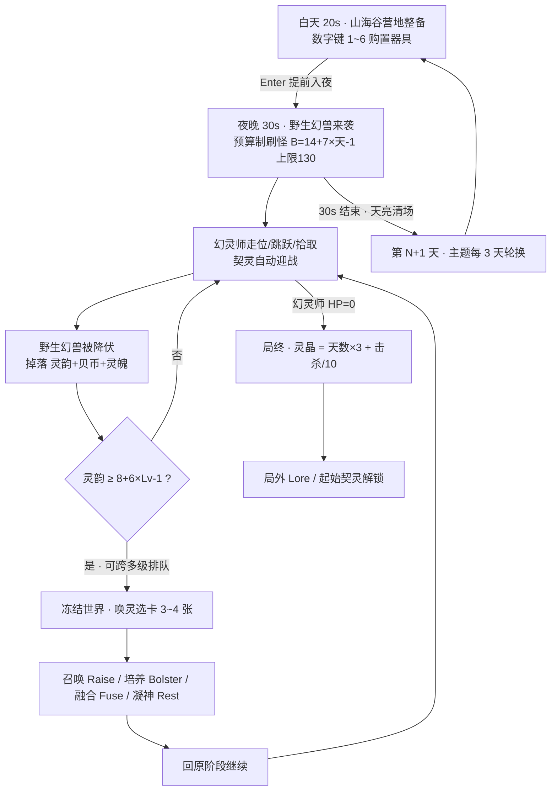
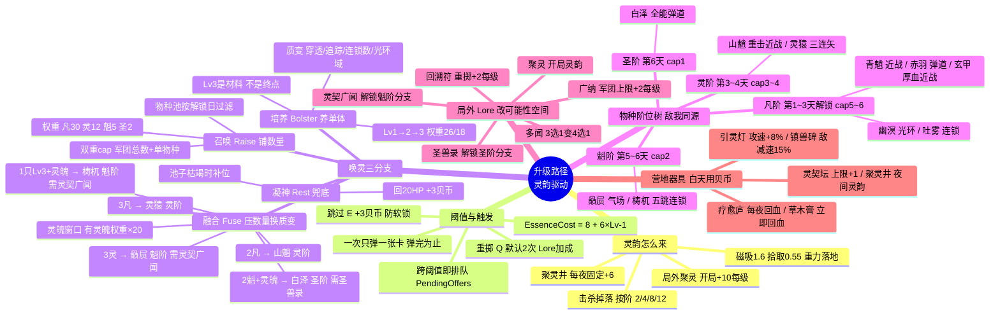
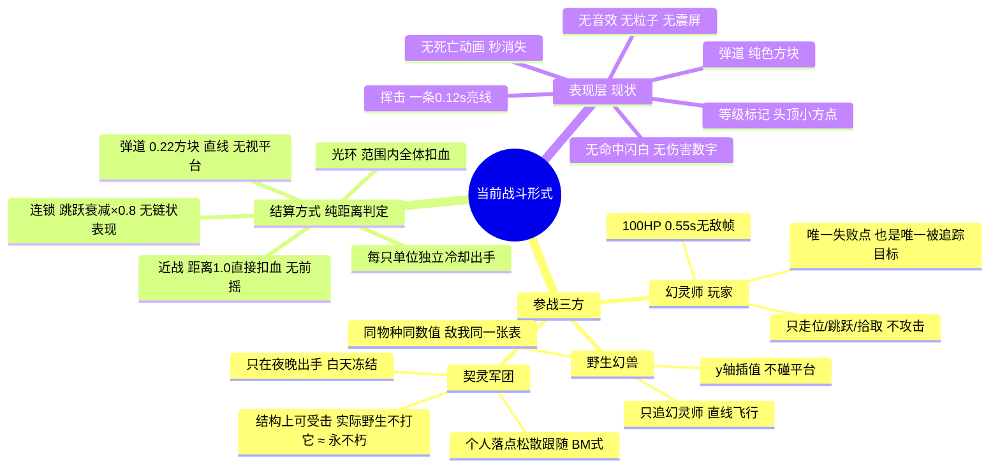

# 山海幻灵 · 项目现状全景（v0.003）

> 日期 2026-11-12　｜　阅读范围：本工程全部 19 个 C#（约 3.6k 行）+ 参考工程 BoneraiserGodot 全部 10 个 C#（约 3.3k 行）+ 两边 docs
> 用途：作为后续「战斗形式改造」对话的共同底图。所有结论都给出代码出处，可复核。

---

## 0. 一句话总览

**山海幻灵 v0.003 是一个「机器验证通过、真人从未玩过」的垂直切片**：成长内核（灵韵 → 唤灵三分支）已经把 Boneraiser Minions 的骨架搬了过来并且闭环成立；但**战斗形式本身还非常原始**——双方单位都是无碰撞的飞行插值体，结算全是距离判定，表现层只有方块和亮线。你对战斗不满意，从代码上看是有充分理由的，短板清单见第 6 节。

---

## 1. 两个工程是什么关系

| | **BoneraiserGodot**（参考工程） | **山海幻灵**（本体） |
|---|---|---|
| 路径 | `D:\GameProjects\BoneraiserGodot` | `D:\GameProjects\山海幻灵` |
| 定位 | BM 机制还原原型：把拆包结论跑成可运行代码 | 自己的游戏：山海谷幻灵师设定 |
| 视角 | 俯视角单屏竞技场，连续波次 | **横板跳跃** 10 层平台，昼夜节奏 |
| 内容量 | 13 种召唤物 / 8 条融合 / 10 项 Lore | 10 物种 / 5 配方 / 6 Lore / 6 营地器具 |
| 美术 | 原作精灵图（本地拆包，仅研究用） | 16 张 Unity 工程复用 PNG |
| 独有机制 | Seal / Banish、Lore 可出售 respec、**敌人三类抗性**、暴击、冲刺无敌帧、Heroic 自愿难度 | 平台跳跃手感（土狼/缓冲/顶点滞空）、昼夜+营地、**敌我同源物种表** |

两工程共享同一套**代码骨架**（对应关系逐文件一致）：

```
Defs/GameDefs（三张表） ⇄ Run（本局状态+资源阀门） ⇄ Meta（局外存档）
     ⇄ Legion（军团 Add/LevelUp/Fuse） ⇄ OfferSystem（选卡管线） ⇄ GameRoot（状态机+冒烟）
```

所以：**参考工程里验证过的任何机制，都可以低成本平移进本体**——这是当前最大的结构性优势。

---

## 2. 工程与技术现状

| 维度 | 状态 |
|---|---|
| 引擎 | Godot 4.7.2.stable.mono，GL Compatibility，1280×720，canvas_items 拉伸 |
| 语言 | 全量 C#（19 个 .cs，0 个 .gd，0 个 autoload，0 第三方插件） |
| 场景 | `Main.tscn` 只挂 GameRoot，其余节点全部运行时程序化生成 |
| 编译验证 | `dotnet build` 0 警告 0 错误；headless 导入退出码 0 |
| 冒烟验证 | `--smoke` 无头跑 3 昼夜，**24/24 断言 PASS**（`docs/smoke-report.json`） |
| 版本 | git tag v0.001 → v0.002 → v0.003，每次 +0.001 |
| 代码组织 | `core/` 7（状态与表）＋ `gameplay/` 9（战斗与世界）＋ `ui/` 3 ＋ `tools/` 白箱 |

**诚实边界**（README 第 8 节原文口径）：真人 Play Mode 0 次；无音效、无动画状态机、无粒子、无对象池；幻灵/幻兽是飞行体不参与平台碰撞；中文靠系统字体。

---

## 3. 核心循环（现状）



要点：
- **升级不再是「天亮三选一」**：灵韵跨阈值即时冻结世界开卡（`GameRoot._Process` 每帧检查 `PendingOffers`）。
- **白天是纯整备时间**：只有买营地器具一件事，没有敌人、没有拾取（`Spirit.cs:100` 契灵白天也冻结）。
- **天亮清场**：野怪、弹道、掉落全部销毁（`SpiritWorld.OnDawn`），存活不留到白天。

---

## 4. 升级路径（思维导图 · 本文档核心）



**这套路径当前的实际体感**（按数值推演，未真人验证）：
- 灵韵阈值 8/14/20/26/32…：一夜预算 14~21 只怪、每只掉 2~12 灵韵 → **前 3 夜每夜大约触发 2~4 次唤灵**，节奏偏密但建立在「冒烟注入 +200 伤害」的假数值上，真实 DPS 下大概率偏慢。
- 培养 vs 召唤的权重接近（26/18 vs 30），融合权重大幅偏低（4~18，有灵魄才 ×20）→ 前期几乎必然走「铺数量 + 养 1~2 只」路线，融合是中期才打开的选项。
- 分类 cap（6/6/5/5/5/4/3/2/2/1）+ 军团上限 8：**堆同一种单位在数学上不成立**，但物种之间没有克制关系，混编目前只是「为了绕 cap」，不是「为了打针对」。

---

## 5. 战斗形式现状（拆开看）



五个关键事实（全部有代码出处）：

1. **野怪 AI 只有一条路**：直线飞向幻灵师 + y 轴插值（`Spirit.MoveWild`，`Spirit.cs:117`），互相之间没有分离力（`Separate()` 只对契灵调用）→ 野怪会叠成一坨穿透平台冲脸。
2. **野怪只打幻灵师**：`AttackMaster` 是野生侧唯一攻击函数（`Spirit.cs:218`），契灵「结构上可受击、实际永不掉血」——没有前线概念，也没有「保住哪只幻灵」的取舍。
3. **玩家没有任何主动防御手段**：没有冲刺/闪避（对比 BM 原型 `Boneraiser` 有带无敌帧的冲刺），跳跃只能躲弹道，近战怪贴脸后只能靠 0.55s 无敌帧硬抗。
4. **四种攻击型对目标没有差异化**：野怪侧光环≈近战（都是 dist<1.0 扣血，`Spirit.cs:221`）、野怪侧连锁≈单发弹道；BM 的「敌人抗性表 × 三类攻击 → 必须混编」在山海**没有对应物**，`AttackKind` 目前只决定出手方式，不决定「打谁划算」。
5. **平台层对战斗是装饰**：战斗单位全部是飞行插值体，10 层平台只约束幻灵师一个人；跳跃手感做了《终焉之莉莉》式的完整调参接口（土狼/缓冲/顶点滞空/变高跳，`GameDefs.cs:100-117`），但**战斗根本用不到这套手感**。

---

## 6. 战斗形式短板清单（为什么可能不满意）

按「体感影响 × 改造成本」排序：

| # | 短板 | 证据 | 体感后果 |
|---|---|---|---|
| 1 | 无命中反馈：受击不闪白、无伤害数字、无死亡动画 | `Spirit.TakeDamage` 只扣数字，`Die()` 直接 QueueFree | 打击感为零，DPS 高低全靠脑补 |
| 2 | 野怪无分离、无走位变化 | `MoveWild` 直线+插值 | 战场是一坨叠着的怪匀速飘向玩家，不像「迎战」 |
| 3 | 玩家无主动战斗动词 | `Master.cs` 只有移动+跳跃 | 平台跳跃的机动性没有兑换成战斗价值，等于在跑图 |
| 4 | 攻击型无克制关系 | `GameDefs` 无 EnemyEffectiveness 对应物 | 军团构成失去战术维度，混编只被 cap 逼出来 |
| 5 | 契灵不朽 | 野生 AI 只攻击 master | 没有「守护/牺牲」决策，融合献祭也感觉不到痛 |
| 6 | 无前摇/无闪避窗口 | 近战 dist<1.0 即扣血 | 被蹭血不可读，无敌帧成了唯一机制 |
| 7 | 白天 20 秒是死时间 | 无敌人/无拾取，只有 6 个购买按钮 | 节奏断裂，且和「升级不再等天亮」的新内核脱节 |
| 8 | 光环/连锁无表现 | 光环=一条亮线，连锁无链 | 高阶质变（魁/圣阶的核心卖点）看不见 |
| 9 | 无 Boss 波次 | 刷怪池权重均匀，无精英/领主机制 | 魁/圣阶野生幻兽出场和凡阶一个待遇 |
| 10 | 无对象池、O(n²) 距离判定 | `Nearest` 全组遍历、`Separate` 逐对 | 军团+怪量上来后帧率风险 |

---

## 7. 与 BM 参考原型的差距表（战斗相关部分）

| 机制 | BoneraiserGodot | 山海幻灵 | 差距定性 |
|---|---|---|---|
| 玩家防御动词 | 冲刺 660px/s + 无敌帧，冷却 1.8s | 无 | **结构性缺失** |
| 敌我交互 | meanies 追玩家但近战互殴单位各自选目标 | 野怪只追玩家 | 结构性缺失 |
| 抗性克制 | 三类攻击 × 五档抗性表（幽魂物理免疫） | 无 | 结构性缺失 |
| 命中反馈 | 红闪 + 命中尘团 + 暴击大尘团 + 尸骨爆裂 | 无 | 表现层缺失 |
| 攻击表现 | 原作 swipe/箭矢/法球/法阵精灵 + 攻击动画 | 方块 + 亮线 | 表现层缺失 |
| 波次结构 | 连续波次、逐波解锁敌型 | 昼夜 + 预算制 | 结构不同（设定差异，非缺陷） |
| 随机性驯化 | Seal 本局封印 / Banish 跨局放逐 | 仅重掷 | 未迁移 |
| 难度旋钮 | Heroic Force：主动增强敌人换产出 | 无 | 未迁移 |
| 军团损失 | minion 不朽（同 BM 原作） | 结构对称但实际不朽 | 同 BM，可保持 |

> 注意：BM 原作 minion 本来就不朽，所以「契灵不朽」不算抄漏——问题在于 BM 用「玩家是唯一血条 + 冲刺机动」撑起张力，而山海既没有冲刺、又把平台跳跃这一强机动性浪费在了与战斗无关的跑图上。

---

## 8. 战斗改造的候选方向（仅列选项，待共同决策）

1. **给玩家一个防御动词**：冲刺/闪避（BM 已验证）或「跳跃下砸 / 二段跳」——把横板机动性变成战斗资源。
2. **把抗性表搬过来**：AttackKind × 幻兽抗性 → 混编军团从「cap 逼出来的」变成「打针对打出来的」。物种表是同一张，改造成本低。
3. **野怪走位改造**：分离力 + 停顿/突进节奏 + 前摇提示，让「迎战」有对抗感。
4. **表现层补课**：受击闪白、伤害数字、死亡爆裂、攻击动画——参考工程里全套特效代码（`Effects.cs`）可直接平移。
5. **让契灵可被击杀**（打破 BM 不朽约束，贴合「幻灵幻兽同一种」的设定）：受伤/阵亡后玩家的融合决策才有代价。
6. **昼夜重定位**：夜晚连续波次化，白天缩短为营地整备的「选单」，或把白天做成跑图探索段。

---

## 9. 遗留的未答问题（来自 design-freeze.json）

| ID | 问题 | 与战斗改造的关系 |
|---|---|---|
| Q1 | 真人 Play 结论（跳跃落点/相机/面板可读性） | 一切数值调参的前提 |
| Q2 | ★助手提案 7 项是否保留（灵韵公式节奏） | 决定升级频率 |
| Q3 | 昼夜是否保留 | 决定战斗节奏容器 |
| Q4 | 是否做「击败野生幻兽当场收服」 | 与融合体系直接竞争 |
| Q5 | 契灵是否应当可阵亡 | 战斗张力核心 |
| Q7 | 物种扩量 vs 现有 10 种做深 | 内容量 vs 战斗深度 |

---

*本文档由对话生成于 2026-11-12，基于 v0.003 代码库逐文件阅读；所有行号以当时版本为准。*
